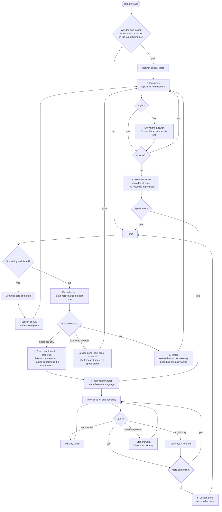

# How a learner moves through the app

Who this is for: a migrant worker in Singapore with little English, often little schooling, a cheap Android phone, and ten minutes between shifts. Three things follow from that, and every decision below comes back to one of them.

1. **They will be interrupted.** A supervisor, a phone call, the end of a break, or the phone closing the app to free memory. Nothing they have done may be lost to that.
2. **They may read very little, in any language.** What to do next is always one large button in view. Where a lesson stands is shown by a colour and a picture (an empty outline, a yellow clock, a green tick) as well as words.
3. **They came for one real situation.** Somebody going to the clinic tomorrow needs the clinic lesson today. Nothing is ever locked; the app only suggests an order.

## The whole journey

## What each stage is for

| Stage | What the learner does | Why it is there |
|---|---|---|
| Words | Looks at each English word with its meaning in their language. Taps to hear it. Starts when ready. | The first question used to be about a word nobody had shown them. Guessing right teaches nothing; guessing wrong teaches that the app is a test. |
| Exercises | Eight to ten short tasks, all taps: choose a picture, match pairs, listen and choose, put words in order, pick a reply. | A keyboard is the biggest obstacle for this learner, so there is none. |
| Exercises done | Sees the sentences they can now say and one thing worth knowing in Singapore. Both stages are shown, the first ticked and the second next, and one button leads on to speaking. | Ends on what they can do, not on a score, and does not say "Lesson done" about half a lesson. |
| Speaking | A tutor sets a scene in the learner's language and asks for each sentence in turn. | The exercises teach what the words mean. This is where they get said. It is the second stage of the lesson, not an extra after it. |
| Lesson done | Sees which sentences they said alone and which with help. | Help is shown as practice, never as failure. |

## When is a lesson done?

A lesson is two stages, the exercises and the talk with the tutor, and it is done when both are. Finishing the exercises used to tick the lesson off, which told every learner the talk was optional, and most of what the lesson is for went unsaid. Now:

| Where the lesson stands | On Home | Counts as done |
|---|---|---|
| Not started | Empty outline, grey "Not started" | No |
| Exercises part-way | Yellow, "In progress", a bar with "4 of 9 done" | No |
| Exercises finished, talk still to do | Yellow, "In progress", "Next: speaking". The Continue card at the top leads to the talk | No |
| Talk part-way | Yellow, "In progress", a bar with "Speaking: 1 of 3 done" | No |
| Exercises and talk finished | Green with a tick, "Done" | Yes |

Putting the talk off is always allowed ("Speak later"): somebody on a crowded train cannot speak aloud, and the lesson waits for them in progress. A lesson with nothing to say aloud, and the daily mix, are done by their exercises alone. Nothing new is stored for any of this: a lesson record with a speaking result is a done lesson, so records made before this rule simply show as in progress until the talk is had. The rule is `lessonStatus` in `lib/progress/model.ts`.

## When is speaking practice finished?

It is not open-ended. A talk has a fixed list of goals: the sentences and words the run just taught that have a meaning in the chosen language, usually three or four. The counter beside the progress bar (`2/4`) shows how far along it is.

Each goal ends in one of two ways, and the server decides which, not the model:

- **Said.** The recording is written down by a request that knows nothing about the lesson, then judged against the goal's key words.
- **Helped.** After the third miss the tutor says the English for them and moves on.

A question, or talk about something else, does not use a try, up to four times a goal. When the last goal ends, the talk ends, and it is recorded then, not when the results screen is closed. Rules: `apps/api/src/tutor.ts` (`decideOutcome`, `MAX_ATTEMPTS`, `MAX_ASIDES`).

## What is remembered, and where

| What | Where | For how long |
|---|---|---|
| Finished lessons: when, how many times, best first-try score, speaking result | The phone, and copied to the server | For good. A new phone gets it back on sign-in. |
| A lesson in progress: the queue, how far the learner has got, each answer's record | The phone only | 14 days, until the lesson's exercises change, or until the learner starts it again |
| A talk in progress: the words of each turn, the goal and try number | The phone only | 24 hours |
| The screen to reopen on | The phone only | 30 minutes, and cleared when the learner leaves by choice |

Nothing is saved "on exit", because on Android there often is no exit: the phone stops the app without telling it. Every answer and every tutor turn is written down as it happens.

What is deliberately not kept: the answer being built (an exercise comes back at its start), recordings (deleted once sent), and the tutor's voice files (a talk picked up later shows its earlier lines as text).

Leaving a lesson asks no "are you sure?". The place is kept, so leaving costs nothing, and a dialog is one more thing to read.

## Going back, and starting again

Every step has Back beside its main button: the word list, each exercise, the exercises' results, the speaking page, the talk and its results. Workshop facilitators walk a room through a lesson together and need to go back to explain something without leaving it.

| From | Back goes to |
|---|---|
| The word list | Home |
| The first exercise | The word list (the daily mix has none, so its first exercise has no Back) |
| Any later exercise | The exercise before |
| The exercises' results | The last exercise |
| A finished lesson's "done" page | Its last exercise, opened as a review |
| The speaking page, the talk, or the talk's open error | The lesson (the daily mix goes Home) |
| The talk's results | The talk |

Stepping back is for looking again, not a second attempt. An exercise already answered can be tried again and is graded, but nothing is recorded: the score, the mistake queue, the progress bar and the saved place stay where the learner had got to, and Next walks forward again without answering. A review of a finished lesson opens on its last exercise with every one counted as answered; it saves and records nothing, and its end is the "done" page it came from. Back from speaking takes the place of the speaking screen rather than stacking on it, so Close on the lesson still goes Home. The talk is kept, so coming back to speaking carries it on.

Once there is an answer to lose, a quiet restart key sits in the lesson's top bar, opposite Close. It asks first, in place of the footer, with "Keep going" as the main button. Starting again goes back to the first exercise and forgets the saved place, so leaving straight after does not bring the old run back.

Android's own back gesture is unchanged: it leaves the lesson, and the place is kept.

Back to an answered exercise, Back, Check and Next share the footer. Back and Next are arrows then, still named for screen readers, so Check keeps its room in a language with long words. Each exercise, and the results, opens scrolled to its top; grading leaves the scroll where it is.

A tap on a lesson's footer straight after it changed is let fall for 400 ms (`components/ui/PressGuard.tsx`). The next step often puts a live button exactly where the last one was: a double tap on Finish used to skip the results for speaking, and one on Check graded the answer and moved on before the learner saw it. Back and Next stay live after a press of their own kind, so a learner stepping quickly is not slowed. The restart question is guarded the same way, and closes if the exercise changes under it.

Two copies of a learner's progress are merged by taking, for each lesson, the latest date, the highest run count and the best result. Two results with the same share right (nine of nine against ten of ten, which is one lesson done in two languages) are settled by the larger total, never by which side is merging, or the phone and the server would each keep their own and swap them on every sync. Nothing is ever taken away, so it does not matter which phone syncs first. The rule is the same on the phone (`lib/progress/model.ts`) and on the server (`src/progress.ts`). Progress is kept per account, because a phone shared in a dormitory is common, and it is removed from both places when the account is deleted.

## Edge cases that are handled

- The phone closes the app mid-exercise, or mid-talk while a recording is being sent. The learner comes back to that exercise, or to that goal on the same try.
- The learner answers the last exercise and leaves on its feedback, without pressing Finish. The lesson is finished by its last answer, so it is recorded; it used to wait for the button, and they came back to do that exercise again.
- A finished lesson is opened again. It says it is done, with the best score and the words, and leaves going through it again as a choice. It does not open on its first question as if nothing had been kept. One whose talk is still to do says "Exercises done" instead, and its main button is the talk.
- The learner steps back to earlier exercises and closes the app. They come back to the first exercise they had not answered, not to the one they were looking at.
- The learner gets an exercise wrong, steps back, and gets it right. It still comes back once at the end, and still does not count as right first time.
- A missed exercise comes back with its options in a different order, so the retry is answered by knowing the answer rather than where its tile was. After a miss the footer says "The right answer:", not "You can also say:", and a word missed in a gap is struck through in red.
- A matching round finished with a wrong pairing along the way is "Correct!", not "Good, we understand you", and it is not right first time: the results only say "You got everything right the first time" when every answer was.
- The meanings in a matching round never sit on the same row as their words, so reading straight across gives nothing away.
- A finished lesson's page offers "Continue" rather than "Practise again" when another go is already part-way through, because that is what the button does.
- A finished lesson is being gone through again. It is still finished: its tick stays on Home and it still counts towards the lessons done, with the bar showing how far the new run has got.
- The learner changes their language part-way through a lesson. Their place and their answers stand. Only the exercises still ahead are chosen again: a translation exercise whose prompt would now fall back to English is dropped, one that has become possible is added at the end, and the score is out of what was actually queued. What they answered is kept even where the new language would not offer it, so a second change of language still picks the run up. A run whose new language leaves nothing ahead opens on its results and is recorded as finished, rather than thrown away.
- The lesson was edited, or yesterday's daily mix is no longer today's. The saved run is discarded and not offered as something to continue.
- A screen reader was switched on since the run was saved. The run held picture exercises it cannot do, so the lesson starts again.
- No connection. Lessons work fully. Finished lessons sync the next time there is one. Speaking says the tutor could not answer and keeps the recording for another try.
- The tutor service fails mid-talk. The recording is kept and Send is offered again.
- Two people use one phone. Each sees only their own progress, and their own first language. A sync still waiting on the server when the phone changes hands is dropped, so one learner's lessons or language never end up in the next learner's, or on their account.
- The stored file is unreadable or has been tampered with. Bad entries are dropped one by one; the app never fails to open over it.
- An account is deleted while another phone still holds progress. The server refuses the write, so nothing is written back.
